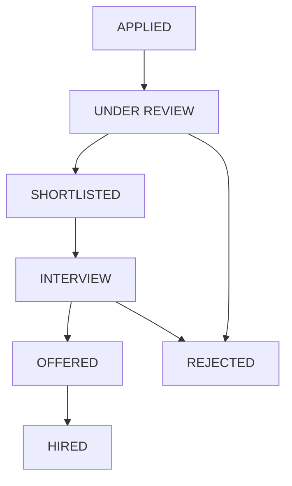

# 🏡 EstateIQ — AI-Powered Real Estate Intelligence Platform

<p align="center">
  <b>Turning Real Estate Data into Smarter Decisions with Artificial Intelligence</b>
</p>

<p align="center">
  
  
  
  
  
</p>

<p align="center">
  <a href="https://github.com/ritesh975/EstateIQ-main">GitHub Repository</a> •
  <a href="https://ritesh-estateiq-main.streamlit.app/">Live Demo</a> •
  <a href="#-features">Features</a> •
  <a href="#-installation--setup">Installation</a>
</p>

---

## 🌟 Overview

**EstateIQ** is an AI-powered real estate intelligence platform designed to explore property-related data and demonstrate how Machine Learning and Deep Learning can support real estate decision-making.

The platform brings multiple AI-powered modules together in one interactive Streamlit application, covering property price estimation, property image classification, demand forecasting, and customer review sentiment analysis.

## ✨ Features

| Module | Description | Technology |
|---|---|---|
| 🇺🇸 US Home Estimate | Estimates historical home prices | Machine Learning |
| 🇮🇳 India Property Estimate | Locality-based property price estimation | Python, ANN |
| 🏠 Room Photo Checker | Classifies room images | CNN, TensorFlow |
| 📈 Demand Forecast | Forecasts property demand | Deep Learning |
| 💬 Review Sentiment | Analyzes customer reviews | RNN, NLP |
| 📊 Explore Datasets | Interactive dataset analysis | Pandas, Streamlit |

## 🧠 AI & Machine Learning Modules

### 1. 🇺🇸 US Home Price Estimation
- Uses historical King County housing data.
- Takes property-related features as input.
- Applies a trained machine learning pipeline.
- Includes renovation-year handling and input validation.

### 2. 🇮🇳 India Property Intelligence
- Explores property prices based on location and characteristics.
- Uses locality-level comparable listing information.
- Provides indicative price references.
- Includes an ANN-based academic model.

### 3. 🏠 Property Image Classification
- Uses a Convolutional Neural Network (CNN).
- Analyzes uploaded room images.
- Predicts room categories such as bedroom, living room, and dining room.
- Includes uncertainty handling.

### 4. 📈 Property Demand Forecasting
- Explores historical demand patterns.
- Applies forecasting techniques.
- Presents results through visualizations.

### 5. 💬 Customer Review Sentiment Analysis
- Uses Natural Language Processing (NLP).
- Applies a Recurrent Neural Network (RNN).
- Processes customer review text.
- Classifies sentiment.

## 🛠️ Tech Stack

**Programming & Development**
- Python
- Jupyter Notebook
- VS Code

**Machine Learning & Deep Learning**
- TensorFlow / Keras
- Scikit-learn
- ANN
- CNN
- RNN

**Data Analysis**
- Pandas
- NumPy
- Matplotlib
- Seaborn

**Visualization & Application**
- Streamlit
- Plotly

**Tools**
- Git
- GitHub

## 📂 Project Structure

```text
EstateIQ-main/
│
├── .streamlit/
│
├── Customer_Review_Sentiment_Analysis_RNN/
│
├── Location Based Price Prediction using ANN/
│
├── Property Image Classification Using CNN/
│
├── Property demand forecast/
│
├── Property prize prediction/
│
├── app.py
├── india_comparable.py
│
├── requirements.txt
├── run_app.bat
│
├── validate_india_module.py
├── validate_model_assets.py
├── validate_project.py
│
├── APP_REPAIR_REPORT.md
├── VALIDATION_REPORT.txt
├── EstateIQ_Application_Movement_Architecture.png
└── README.md
```

## 🏗️ Application Movement Architecture

This architecture represents the application's workflow, backend processing, database interaction, and application status movement.


### 🔄 Application Lifecycle



### Architecture Components

- **Frontend:** React SPA deployed on Vercel.
- **API Layer:** API Rewrite and Express API.
- **Controllers:** Handle requests and application status updates.
- **Services:** Manage business logic and workflow rules.
- **MongoDB Models:** Manage application and candidate data.
- **MongoDB:** Stores application records and status history.
- **Upload System:** Multer and file validation.
- **Socket.IO:** Supports real-time status updates.

## ⚙️ Installation & Setup

### Prerequisites

- Python 3.12
- Git
- VS Code (recommended)

### Step 1: Clone the Repository

```bash
git clone https://github.com/ritesh975/EstateIQ-main.git
```

### Step 2: Navigate to the Project Folder

```bash
cd EstateIQ-main
```

### Step 3: Create a Virtual Environment

```bash
py -3.12 -m venv .venv
```

### Step 4: Activate the Environment

**Windows PowerShell:**

```powershell
.\.venv\Scripts\Activate.ps1
```

### Step 5: Install Dependencies

```bash
python -m pip install --upgrade pip
pip install -r requirements.txt
```

### Step 6: Run the Application

```bash
python -m streamlit run app.py
```

Open the local URL displayed in your terminal, usually:

```text
http://localhost:8501
```

## 📊 Project Highlights

- Multiple AI and Deep Learning modules integrated into one application.
- Interactive web interface built using Streamlit.
- Data preprocessing and model-based prediction workflows.
- Visual exploration of real estate datasets.
- Input validation and uncertainty-aware predictions.
- Modular project structure for easier maintenance.

## ⚠️ Important Notes

- US Home Estimate uses historical King County housing data and should not be treated as a current market valuation.
- India Property Estimate provides indicative comparable-based references.
- Room Photo Checker is an academic image-classification model.
- The Review Sentiment module requires its dataset. The large `Reviews.csv` file is not included in this GitHub repository due to its size.
- Forecasting and prediction results depend on available datasets and model performance.

**EstateIQ is an academic and demonstration project, not a professional property valuation or investment advisory service.**

## 🚀 Future Enhancements

- Integration of live real estate market data.
- Improved prediction accuracy with larger datasets.
- Interactive geographical property visualizations.
- More advanced demand forecasting models.
- Enhanced user experience and reporting features.
- Cloud deployment and scalable model serving.

## 👨‍💻 Developer

**Ritesh Kumar Kasaudhan**

Master of Computer Applications (MCA)  
Invertis University, Bareilly, Uttar Pradesh

Interested in Data Analytics, Machine Learning, Deep Learning, and AI-powered applications.

<p align="center">
  <a href="https://github.com/ritesh975">
    
  </a>
</p>

<p align="center">
  <a href="https://github.com/ritesh975/EstateIQ-main">📂 GitHub Repository</a> |
  <a href="https://ritesh-estateiq-main.streamlit.app/">🚀 Live Demo</a>
</p>

---

<p align="center">
  ⭐ If you find this project interesting, consider giving it a star!
</p>

<p align="center">
  <b>EstateIQ — Making Real Estate Smarter with AI. 🏡</b>
</p>
